

<picture>
  <source media="(prefers-color-scheme: dark)" srcset="https://raw.githubusercontent.com/vitaliipavlov1/vitaliipavlov1/main/assets/banner-dark.gif">
  
</picture>

# Vitalii Pavlov

**Real-Time Embedded Systems & Computer Vision Engineer**

 &nbsp;**Master's Degree Candidate in Data Science** — UOC, Universitat Oberta de Catalunya · present

Spain · Remote &nbsp;|&nbsp; [LinkedIn](https://www.linkedin.com/in/vitaliipavlov1) &nbsp;|&nbsp; pavlov.v.mail1@gmail.com

I build low-latency perception and signal-processing systems, from sensor data to a
deployed, observable service.

<h2 align="center">Tech stack</h2>

<picture><source media="(prefers-color-scheme: dark)" srcset="assets/stack/python-dark.svg">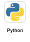</picture>
<picture><source media="(prefers-color-scheme: dark)" srcset="assets/stack/cpp-dark.svg"></picture>
<picture><source media="(prefers-color-scheme: dark)" srcset="assets/stack/ultralytics-dark.svg"></picture>
<picture><source media="(prefers-color-scheme: dark)" srcset="assets/stack/mediapipe-dark.svg"></picture>
<picture><source media="(prefers-color-scheme: dark)" srcset="assets/stack/huggingface-dark.svg"></picture>
<picture><source media="(prefers-color-scheme: dark)" srcset="assets/stack/zero-shot-dark.svg"></picture>
<picture><source media="(prefers-color-scheme: dark)" srcset="assets/stack/slam-dark.svg"></picture>
<picture><source media="(prefers-color-scheme: dark)" srcset="assets/stack/pytorch-dark.svg"></picture>
<picture><source media="(prefers-color-scheme: dark)" srcset="assets/stack/opencv-dark.svg">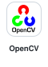</picture>
<picture><source media="(prefers-color-scheme: dark)" srcset="assets/stack/pcl-dark.svg">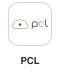</picture>
<picture><source media="(prefers-color-scheme: dark)" srcset="assets/stack/shapely-dark.svg"></picture>
<picture><source media="(prefers-color-scheme: dark)" srcset="assets/stack/cuda-dark.svg"></picture>
<picture><source media="(prefers-color-scheme: dark)" srcset="assets/stack/tensorrt-dark.svg"></picture> 
<picture><source media="(prefers-color-scheme: dark)" srcset="assets/stack/triton-dark.svg"></picture>
<picture><source media="(prefers-color-scheme: dark)" srcset="assets/stack/cmake-dark.svg"></picture>
<picture><source media="(prefers-color-scheme: dark)" srcset="assets/stack/docker-dark.svg"></picture>
<picture><source media="(prefers-color-scheme: dark)" srcset="assets/stack/nginx-dark.svg"></picture>
<picture><source media="(prefers-color-scheme: dark)" srcset="assets/stack/git-dark.svg"></picture>
<picture><source media="(prefers-color-scheme: dark)" srcset="assets/stack/bot-sort-dark.svg"></picture>
<picture><source media="(prefers-color-scheme: dark)" srcset="assets/stack/bytetrack-dark.svg"></picture>
<picture><source media="(prefers-color-scheme: dark)" srcset="assets/stack/deepsort-dark.svg"></picture>
<picture><source media="(prefers-color-scheme: dark)" srcset="assets/stack/optical-flow-dark.svg"></picture>
<picture><source media="(prefers-color-scheme: dark)" srcset="assets/stack/fastapi-dark.svg"></picture>
<picture><source media="(prefers-color-scheme: dark)" srcset="assets/stack/gstreamer-dark.svg"></picture>
<picture><source media="(prefers-color-scheme: dark)" srcset="assets/stack/websockets-dark.svg"></picture> 
<picture><source media="(prefers-color-scheme: dark)" srcset="assets/stack/rest-dark.svg"></picture>
<picture><source media="(prefers-color-scheme: dark)" srcset="assets/stack/streamlit-dark.svg"></picture>
<picture><source media="(prefers-color-scheme: dark)" srcset="assets/stack/aws-dark.svg"></picture>
<picture><source media="(prefers-color-scheme: dark)" srcset="assets/stack/systemd-dark.svg">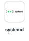</picture>
<picture><source media="(prefers-color-scheme: dark)" srcset="assets/stack/prometheus-dark.svg"></picture>
<picture><source media="(prefers-color-scheme: dark)" srcset="assets/stack/postgresql-dark.svg"></picture>
<picture><source media="(prefers-color-scheme: dark)" srcset="assets/stack/nosql-dark.svg">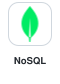</picture>
<picture><source media="(prefers-color-scheme: dark)" srcset="assets/stack/numpy-dark.svg"></picture>
<picture><source media="(prefers-color-scheme: dark)" srcset="assets/stack/pandas-dark.svg"></picture>
<picture><source media="(prefers-color-scheme: dark)" srcset="assets/stack/scikit-learn-dark.svg">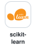</picture>
<picture><source media="(prefers-color-scheme: dark)" srcset="assets/stack/mlflow-dark.svg"></picture>
<picture><source media="(prefers-color-scheme: dark)" srcset="assets/stack/ml-dark.svg"></picture> 
<picture><source media="(prefers-color-scheme: dark)" srcset="assets/stack/cvat-dark.svg">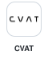</picture>
<picture><source media="(prefers-color-scheme: dark)" srcset="assets/stack/matplotlib-dark.svg">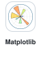</picture>
<picture><source media="(prefers-color-scheme: dark)" srcset="assets/stack/seaborn-dark.svg"></picture>
<picture><source media="(prefers-color-scheme: dark)" srcset="assets/stack/html-dark.svg"></picture>
<picture><source media="(prefers-color-scheme: dark)" srcset="assets/stack/javascript-dark.svg"></picture>
<picture><source media="(prefers-color-scheme: dark)" srcset="assets/stack/jetson-dark.svg"></picture>
<picture><source media="(prefers-color-scheme: dark)" srcset="assets/stack/gazebo-dark.svg"></picture>
<picture><source media="(prefers-color-scheme: dark)" srcset="assets/stack/ros2-dark.svg"></picture>
<picture><source media="(prefers-color-scheme: dark)" srcset="assets/stack/px4-dark.svg"></picture>
<picture><source media="(prefers-color-scheme: dark)" srcset="assets/stack/realtime-dark.svg"></picture>
<picture><source media="(prefers-color-scheme: dark)" srcset="assets/stack/fusion-dark.svg"></picture>
<picture><source media="(prefers-color-scheme: dark)" srcset="assets/stack/kalman-dark.svg"></picture>

## Featured projects

<table>
  <tr>
    <td width="50%" valign="top">
      <a href="https://github.com/vitaliipavlov1/Multimodal-CV-System"><b>Multimodal-CV-System</b></a> 
      Detection, tracking, pose, OCR and optical flow over WebSocket, served with Triton + TensorRT FP16 on AWS, with Prometheus metrics.  
      <a href="https://github.com/vitaliipavlov1/Multimodal-CV-System">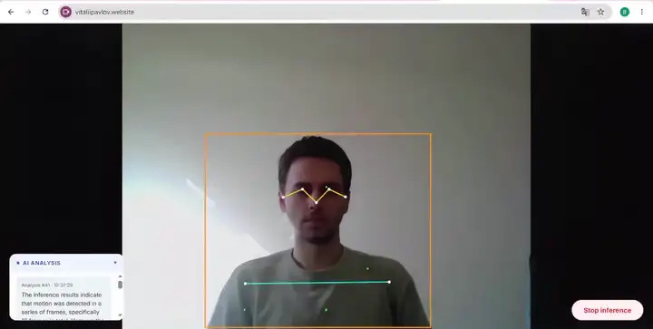</a>
    </td>
    <td width="50%" valign="top">
      <a href="https://github.com/vitaliipavlov1/RTAB-SLAM"><b>RTAB-SLAM</b></a> 
      Real-time RGB-D SLAM for the Intel RealSense D435i on RTAB-Map: live 3D/2D maps, loop closure, IMU gravity constraints, offline validation.  
      <a href="https://github.com/vitaliipavlov1/RTAB-SLAM">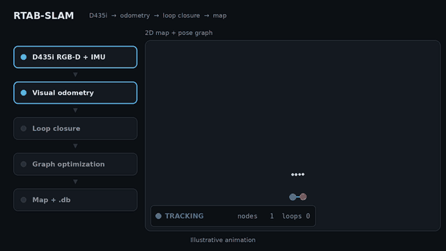</a>
    </td>
  </tr>
  <tr>
    <td width="50%" valign="top">
      <a href="https://github.com/vitaliipavlov1/LidarView"><b>LidarView</b></a> 
      Reproducible LiDAR playback, validation and SLAM benchmarking on top of Kitware LidarView 5.3.0: checksum-pinned runtime and datasets, packet-level PCAP validation, headless reader → SLAM pipeline check.  
      <a href="https://github.com/vitaliipavlov1/LidarView">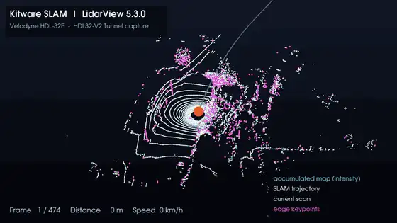</a>
    </td>
    <td width="50%" valign="top">
      <a href="https://github.com/vitaliipavlov1/RadarRT-DSP"><b>RadarRT-DSP</b></a> 
      Embedded Linux C++17 real-time radar DSP pipeline (simulated source): SCHED_FIFO, priority-inheritance queues, watchdog, ordered shutdown, ASan/UBSan/TSan in CI.  
      <a href="https://github.com/vitaliipavlov1/RadarRT-DSP">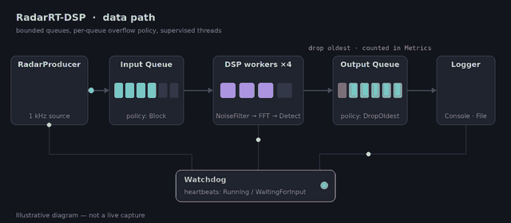</a> 
      <a href="https://github.com/vitaliipavlov1/RadarRT-DSP">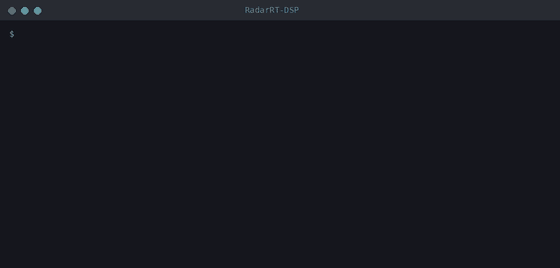</a>
    </td>
  </tr>
</table>

## Languages

Ukrainian (C2) · English (C1) · Spanish (C1)
